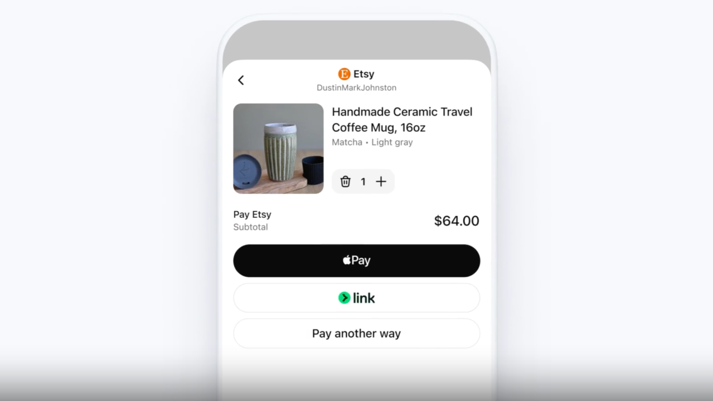
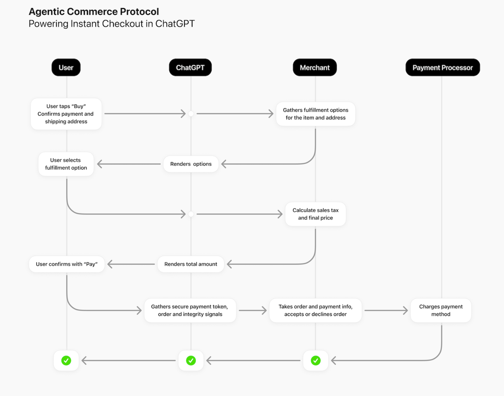

Chaque semaine, plus de 700 millions de personnes utilisent ChatGPT pour les aider dans leurs tâches quotidiennes. Parmi ces utilisateurs, beaucoup cherchent des produits et demandent des recommandations d'achat. Jusqu'à présent, ChatGPT se contentait de suggérer des produits. Désormais, il permet de les acheter directement dans l'interface de chat.

OpenAI vient d'annoncer le lancement du Paiement instantané dans ChatGPT, une fonctionnalité qui permet d'acheter des produits sans quitter la conversation. Cette nouveauté repose sur l'Agentic Commerce Protocol, un protocole ouvert développé en collaboration avec Stripe et des partenaires marchands.

Cette évolution marque une nouvelle étape dans ce qu'OpenAI appelle le « commerce agentique » : ChatGPT ne se contente plus de recommander, il peut maintenant agir comme un agent d'achat pour l'utilisateur. Pour les acheteurs, cela signifie passer du chat au paiement en quelques clics. Pour les vendeurs, c'est une nouvelle façon d'atteindre des centaines de millions de personnes tout en gardant le contrôle total de leurs paiements, de leurs systèmes et de leurs relations client.

## Comment fonctionne le Paiement instantané pour l'utilisateur

### L'expérience d'achat

Lorsqu'un utilisateur pose une question shopping dans ChatGPT (par exemple « meilleures chemises à moins de 100 € » ou « idées cadeaux pour un passionné de céramique »), ChatGPT affiche les produits les plus pertinents sur le web. Les résultats sont naturels et non sponsorisés, classés uniquement en fonction de leur pertinence pour l'utilisateur.

Si un produit est compatible avec les paiements instantanés, l'utilisateur peut simplement appuyer sur « Acheter ». Il confirme ensuite sa commande, ses informations de livraison et de paiement, puis finalise l'achat sans jamais quitter la conversation. Les abonnés ChatGPT existants peuvent régler avec la carte enregistrée dans leur compte, ou choisir une autre carte ainsi que des options de paiement express.

### Le rôle de ChatGPT

Dans ce processus, ChatGPT agit comme l'agent IA de l'utilisateur. Il transmet des informations de manière sécurisée entre l'utilisateur et le marchand, exactement comme le ferait un personal shopper numérique. Mais il ne gère ni les commandes, ni les paiements, ni les livraisons : tout cela reste du ressort du marchand via ses systèmes existants.

### Disponibilité actuelle

Le Paiement instantané est disponible pour les utilisateurs de ChatGPT Plus, Pro et Free aux États-Unis. Actuellement, les utilisateurs peuvent acheter auprès de vendeurs Etsy américains, avec plus d'un million de marchands Shopify (comme Glossier, SKIMS, Spanx et Vuori) qui arrivent bientôt.

Pour le moment, le paiement instantané ne prend en charge que l'achat d'un seul article à la fois. La prochaine étape prévoit l'ajout de paniers multi-articles et l'extension à davantage de marchands et de régions géographiques.

### Modèle économique

Le service est entièrement gratuit pour les utilisateurs. Les marchands paient une petite commission sur les achats effectués, mais cela n'a aucun impact sur le prix affiché. Cette commission n'influence pas non plus les résultats de produits affichés par ChatGPT : les articles avec paiement instantané ne sont pas privilégiés dans les résultats.

Lorsque plusieurs marchands proposent le même produit, ChatGPT prend en compte différents facteurs pour les classer : disponibilité, prix, qualité, statut de vendeur principal, et activation du Paiement instantané, le tout dans le but d'optimiser l'expérience utilisateur.

## L'Agentic Commerce Protocol : une norme ouverte

### Qu'est-ce qu'un protocole ?

Un protocole, dans le monde de la technologie, c'est un ensemble de règles qui permet à différents systèmes de communiquer entre eux. L'Agentic Commerce Protocol (ACP) définit comment les agents IA, les utilisateurs et les entreprises peuvent collaborer pour finaliser un achat.

Ce protocole établit un « langage commun » qui permet à ChatGPT de dialoguer avec les systèmes des marchands, de transmettre des informations d'achat, et de gérer le processus de commande de manière standardisée.

### Le contrôle reste au marchand

Un aspect fondamental de l'Agentic Commerce Protocol est qu'il permet aux marchands de conserver leur relation client. Contrairement à certaines places de marché, le marchand reste le marchand officiel tout au long du processus :

- Les clients achètent directement auprès du marchand
- Le paiement est traité directement par le marchand
- Le marchand décide d'accepter ou de refuser chaque commande
- Le marchand gère toute l'expérience après-achat (livraison, retours, support client)

Les clients verront le nom du marchand sur leur relevé de carte bancaire, comme s'ils avaient acheté directement sur le site web du marchand.

### Open source et communauté

L'Agentic Commerce Protocol est open source, publié sous licence Apache 2.0. Cela signifie que n'importe quelle entreprise peut implémenter la spécification pour effectuer des transactions avec n'importe quel agent IA et n'importe quel prestataire de paiement.

Le protocole est conçu de manière communautaire : OpenAI et Stripe en assurent la gouvernance, mais ils encouragent d'autres acteurs à participer à son développement. Le code et la documentation sont disponibles sur GitHub et sur le site [agenticcommerce.dev](https://www.agenticcommerce.dev/).

## Les trois flux techniques du protocole

Pour fonctionner, l'Agentic Commerce Protocol repose sur trois flux distincts que les marchands doivent implémenter. Chacun a un rôle spécifique dans le processus d'achat.

### Premier flux : le catalogue produits

**À quoi ça sert.** Le Product Feed Spec définit comment les marchands partagent leurs données produits avec OpenAI. Sans ce flux, ChatGPT ne saurait pas quels produits existent, à quel prix, s'ils sont en stock, etc.

**Comment ça fonctionne.** Les marchands fournissent un fichier de données sécurisé et régulièrement actualisé, dans l'un des formats suivants : TSV, CSV, XML ou JSON. Ce fichier contient des informations clés sur chaque produit : identifiants, descriptions, prix, disponibilité, images, options de livraison, etc.

**Champs requis et recommandés.** Certains champs sont obligatoires pour assurer un affichage correct du prix, de la disponibilité et du statut d'achat. D'autres champs sont recommandés (comme les médias enrichis, les avis clients, ou les indicateurs de performance) car ils améliorent le classement, la pertinence et la confiance des utilisateurs.

**Mise à jour en temps réel.** L'intégration implique de configurer une connexion HTTPS chiffrée, d'envoyer un échantillon de flux initial pour validation, puis de supporter des mises à jour fréquentes. Le protocole permet des actualisations aussi régulières que toutes les 15 minutes, ce qui garantit que les informations produits restent à jour (prix, disponibilité, etc.).

### Deuxième flux : la gestion des commandes

**Le rôle de ChatGPT comme agent.** L'Agentic Checkout Spec permet à ChatGPT d'agir comme l'agent IA du client et de générer une expérience de paiement intégrée dans l'interface de ChatGPT. Mais attention : même si l'interface de paiement s'affiche dans ChatGPT, le traitement réel de la commande se fait sur les systèmes du marchand.

**Le processus en quatre étapes :**

1. ChatGPT collecte les informations de l'acheteur : adresse de livraison, méthode de paiement, et autres détails nécessaires.
2. ChatGPT appelle les points de terminaison (endpoints) du marchand définis par l'Agentic Commerce Protocol pour créer ou mettre à jour une session de paiement. Il transmet les informations de manière sécurisée.
3. Le marchand effectue la validation : il détermine les options de livraison disponibles, calcule les taxes et les frais de port, analyse les signaux de paiement et de risque sur sa propre infrastructure, et charge la méthode de paiement avec son prestataire habituel. Le marchand décide ensuite d'accepter ou de refuser la commande, et renvoie cet état à ChatGPT.
4. ChatGPT reflète l'état final dans son interface et affiche le message de confirmation (ou de refus) à l'utilisateur.

**Qui fait quoi.** L'interface utilisateur de paiement est dans ChatGPT, mais tout le traitement (validation, calcul des taxes, analyse de risque, facturation) se passe sur les systèmes du marchand. OpenAI transmet les informations, mais c'est le marchand qui décide d'accepter ou refuser la commande, qui facture le paiement, et qui confirme la commande.

Cette architecture garantit que le marchand garde le contrôle total du processus commercial, exactement comme pour n'importe quelle autre commande sur son propre site.

### Troisième flux : les paiements délégués

**Le principe de délégation.** Le Delegated Payment Spec permet à OpenAI de partager de manière sécurisée les informations de paiement avec le marchand ou son prestataire de services de paiement (PSP). Le marchand et son PSP gèrent ensuite la transaction exactement comme n'importe quel autre paiement qu'ils collectent.

**Le processus de paiement :**

1. OpenAI prépare une demande de paiement délégué à usage unique. Cette demande définit un montant maximum facturable et une date d'expiration, basés sur ce que l'utilisateur a sélectionné dans l'interface ChatGPT.
2. Cette information est transmise au PSP de confiance du marchand, qui va gérer la transaction.
3. Le PSP répond avec un jeton de paiement (payment token) qu'OpenAI transmet au marchand pour finaliser le paiement.

**Sécurité et restrictions.** Les jetons de paiement chiffrés ne sont autorisés que pour des montants précis et auprès de marchands spécifiques, avec l'accord explicite de l'utilisateur. Le Delegated Payment Spec d'OpenAI impose des restrictions sur la façon dont ces informations de paiement peuvent être utilisées, pour sécuriser les transactions des utilisateurs.

**Compatibilité des prestataires de paiement.** Le Shared Payment Token de Stripe est la première implémentation compatible avec le Delegated Payment Spec, avec probablement d'autres PSP à venir.

**OpenAI n'est pas le marchand.** Un point crucial : OpenAI n'est pas le marchand officiel (merchant of record) dans l'Agentic Commerce Protocol. Les marchands sont censés apporter leur propre PSP et gérer les paiements comme ils le font pour accepter n'importe quel autre paiement numérique. Le Delegated Payment Spec garantit simplement que des restrictions sont mises en place sur la façon dont ces informations de paiement sont utilisées.

### Le flux complet en pratique

Le diagramme ci-dessous illustre le flux end-to-end de l'Agentic Commerce Protocol, depuis le clic sur « Acheter » jusqu'à la confirmation finale :

## Intégrer l'Agentic Commerce Protocol : les étapes

### Qui peut intégrer ?

La construction avec l'Agentic Commerce Protocol est ouverte à tous. Cependant, le Paiement instantané dans ChatGPT est actuellement disponible uniquement pour les partenaires approuvés. OpenAI prévoit d'intégrer de nouveaux partenaires de manière progressive, en commençant par les États-Unis.

Cas particulier pour Etsy et Shopify : si vous êtes un marchand Etsy ou Shopify, vous n'avez pas besoin de postuler ni de construire une intégration, vous êtes déjà éligible. L'intégration est gérée directement par ces plateformes.

### Les étapes d'intégration

Pour les autres marchands qui souhaitent rendre leurs produits disponibles via le Paiement instantané dans ChatGPT :

1. **Postuler** : remplissez le [formulaire de candidature](https://chatgpt.com/fr-FR/merchants/) pour participer au programme Instant Checkout. OpenAI examine les candidatures et approuve les partenaires de manière progressive.
2. **Partager votre flux produits** : créez et partagez votre flux produits selon le Product Feed Spec. Vous devrez configurer une connexion HTTPS sécurisée et envoyer un échantillon pour validation.
3. **Construire votre API Agentic Checkout** : implémentez les endpoints REST requis, les webhooks pour notifier OpenAI des événements de commande, et retournez un état de paiement enrichi à chaque réponse.
4. **Construire votre intégration de paiement** : utilisez un PSP de confiance conforme au Delegated Payment Spec. Si vous utilisez déjà Stripe, vous pouvez activer les paiements agentiques avec une seule ligne de code. Avec un autre prestataire, vous pouvez passer par la nouvelle Shared Payment Token API de Stripe, ou adopter la spécification des paiements délégués, sans changer de prestataire.

### Gestion des incidents et retours

**Qui gère les remboursements et contestations ?** Le marchand. Puisque c'est lui qui accepte le paiement directement du client en tant que marchand officiel, c'est lui qui est responsable de gérer les remboursements et les contestations de paiement. Les marchands doivent utiliser le webhook `ORDER_UPDATE` pour notifier ChatGPT lorsqu'un statut de remboursement ou de contestation change, afin que l'état de la commande reste synchronisé.

**Livraisons multiples.** Actuellement, le protocole ne gère qu'une seule adresse de livraison et une seule option de livraison par session de paiement. Le support des livraisons fractionnées est prévu pour l'avenir. Si votre système les supporte déjà, vous devez les consolider en une seule sélection visible pour l'acheteur, et retourner des totaux agrégés pour les frais de port et les taxes.

## Conclusion

L'Agentic Commerce Protocol marque une nouvelle étape dans l'évolution du commerce en ligne. En permettant aux agents IA d'agir au nom des utilisateurs pour finaliser des achats, il ouvre la voie à ce qu'OpenAI appelle le « commerce agentique ».

Cette évolution change la nature même de l'expérience d'achat : au lieu de naviguer sur plusieurs sites, de comparer manuellement des options et de remplir des formulaires de paiement, l'utilisateur peut simplement discuter avec ChatGPT et acheter en quelques clics. L'IA devient une interface naturelle pour découvrir, choisir et acheter.

Pour les marchands, c'est un nouveau canal de distribution qui donne accès à 700 millions d'utilisateurs, tout en préservant leur indépendance. Contrairement aux places de marché traditionnelles, l'Agentic Commerce Protocol permet aux marchands de garder le contrôle de leurs systèmes, de leurs paiements et de leurs relations client.

Le déploiement actuel n'est qu'un début : limité aux États-Unis, aux achats d'articles uniques, et à un nombre restreint de marchands (Etsy et Shopify). Mais la roadmap prévoit l'ajout de paniers multi-articles, l'extension à davantage de marchands et de régions, et probablement de nouvelles fonctionnalités comme les livraisons multiples.

À mesure que l'IA devient une interface clé pour le commerce, l'Agentic Commerce Protocol offre une base standardisée qui relie les personnes et les entreprises pour construire la prochaine génération d'expériences d'achat.

OpenAI n'est pas seul sur ce terrain : Google avance également de son côté avec ses propres protocoles pour le commerce agentique. Ce n'est pas le sujet de cet article, mais pour ceux qui souhaitent approfondir, [cette vidéo en parle](https://www.youtube.com/watch?v=enkcI8an49E).

## Sources

- [OpenAI : Acheter dans ChatGPT](https://openai.com/fr-FR/index/buy-it-in-chatgpt/)
- [Documentation Agentic Commerce Protocol](https://www.agenticcommerce.dev/)
- [Le protocole sur GitHub](https://github.com/agentic-commerce-protocol/agentic-commerce-protocol)
