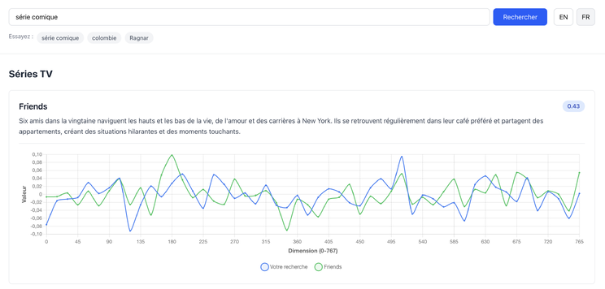
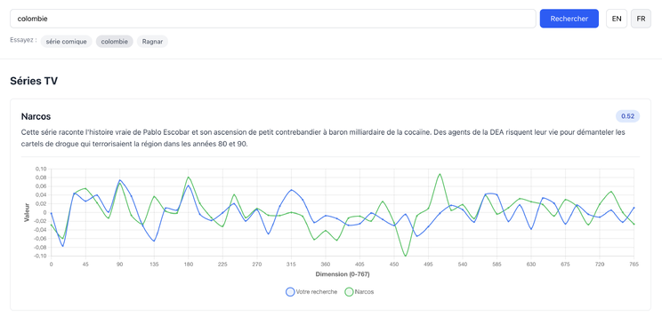

Dans cet article, nous allons voir comment fonctionne la recherche sémantique avec Symfony AI, à travers une petite démo de catalogue de séries TV. (La démo n'est plus en ligne, mais [le code est disponible sur GitHub](https://github.com/Guiziweb/semantic-search-demo) et les extraits ci-dessous en sont directement tirés.)

## Recherche sémantique vs recherche classique

### Le problème de la recherche traditionnelle

Que ce soit une simple requête SQL (`LIKE '%comique%'`) ou une recherche full-text plus avancée (Elasticsearch, etc.), le principe reste le même : on cherche des mots, pas du sens.

- « smartphone » ≠ « téléphone »
- « pas cher » ≠ « économique »
- « rigolo » ≠ « drôle »

Résultat : beaucoup de résultats manqués, des utilisateurs potentiellement frustrés.

### La recherche sémantique

La recherche sémantique transforme le texte en vecteurs mathématiques qui capturent le sens plutôt que les mots exacts. Deux textes avec des mots différents mais un sens similaire auront des vecteurs proches dans l'espace vectoriel.

Concrètement : « smartphone pas cher » peut trouver « téléphone économique », « colombie » peut trouver Narcos, « Ragnar » peut trouver Vikings. Le modèle comprend le sens, pas juste les mots.

Pour illustrer concrètement, nous avons construit un petit moteur de recherche sur un catalogue de séries TV. Exemples de recherches :

- **« Série comique »** → trouve *Friends* (le mot « comique » n'apparaît pas dans la description)
- **« Colombie »** → trouve *Narcos* (le mot « Colombie » n'apparaît pas dans la description)
- **« Ragnar »** → trouve *Vikings* (le nom « Ragnar » n'apparaît pas dans la description)

## Symfony AI : les composants

Dans notre démo, nous utilisons deux composants de Symfony AI.

### symfony/ai-platform : l'abstraction des modèles d'IA

Le composant Platform fournit une interface unifiée pour interagir avec différents fournisseurs d'IA. Ces providers proposent plusieurs types de modèles :

- **LLMs** (génération de texte) : GPT-4, Claude, Gemini, Mistral, etc., pour générer du texte, répondre à des questions
- **Modèles d'embedding** : text-embedding-004, text-embedding-3-large, etc., pour transformer du texte en vecteurs

**Notre choix : Gemini text-embedding-004.** Pour cette démo, nous utilisons le modèle d'embeddings de Google, principalement parce qu'il est gratuit jusqu'à 15 000 requêtes/minute. Mais Symfony AI supporte de nombreux autres providers (OpenAI, Mistral, Anthropic, Ollama pour des modèles locaux, etc.).

```yaml
# config/services.yaml

# AI Platform Configuration
Symfony\AI\Platform\PlatformInterface:
    factory: ['Symfony\AI\Platform\Bridge\Gemini\PlatformFactory', 'create']
    arguments:
        $apiKey: '%env(GEMINI_API_KEY)%'

# Embedder (Vectorizer)
Symfony\AI\Store\Document\VectorizerInterface:
    class: Symfony\AI\Store\Document\Vectorizer
    arguments:
        $platform: '@Symfony\AI\Platform\PlatformInterface'
        $model: 'text-embedding-004'
```

### symfony/ai-store : l'abstraction du stockage vectoriel

Le composant Store fournit une interface simple pour stocker et interroger des vecteurs :

```php
interface StoreInterface
{
    public function add(VectorDocument ...$documents): void;
    public function query(Vector $vector, array $options = []): array;
}
```

- `add()` : ajoute des vecteurs au store
- `query()` : recherche les vecteurs les plus proches

### Les Store Bridges disponibles

Un store sert uniquement à stocker et interroger des vecteurs (pas du stockage générique). Actuellement, Symfony AI Store propose 19 backends différents :

| Catégorie | Stores disponibles | Description |
| --- | --- | --- |
| Local | CacheStore (notre choix) | Utilise le cache Symfony |
| | InMemoryStore | Tout en RAM, temporaire |
| Bases relationnelles | PostgreSQL | Avec extension pgvector |
| | MariaDB | Support vectoriel natif |
| | ClickHouse | Base analytique |
| Bases NoSQL | MongoDB | Recherche vectorielle native |
| | Redis | Avec RediSearch |
| | Neo4j | Base graphe + vecteurs |
| | SurrealDB | Base multi-modèle |
| Vector databases | Pinecone | SaaS dédié aux vecteurs |
| | Qdrant | Open-source, haute performance |
| | Milvus | Scalable, cloud-native |
| | Weaviate | Avec capacités GraphQL |
| | ChromaDB | Simple, embeddings-first |
| Cloud | Azure AI Search | Service Microsoft |
| | Cloudflare Vectorize | Edge computing |
| | Supabase | PostgreSQL + pgvector |
| Moteurs de recherche | Meilisearch | Typo-tolérant + vecteurs |
| | Typesense | Recherche ultra-rapide |

**Notre choix : CacheStore.** Pour cette démo, nous utilisons CacheStore car :

- Zéro configuration
- Parfait pour le développement et les petits catalogues
- Utilise n'importe quel adapter Symfony Cache
- Facile à migrer vers un autre store plus tard

Limitations :

- Pas scalable (charge tout en mémoire)
- Calcul de distance côté PHP (pas optimisé)
- Pas de persistence garantie

```yaml
# config/services.yaml

# Cache-based Vector Store
Symfony\AI\Store\StoreInterface:
    class: Symfony\AI\Store\Bridge\Local\CacheStore
    arguments:
        $cache: '@cache.app'
        $cacheKey: 'semantic_search_vectors'
```

### L'abstraction : avantages et limites

Le gros avantage de `StoreInterface` : même API pour tous les stores (`add()` et `query()`). Mais chaque store a ses propres spécificités :

- **Stratégies de distance** : Cosine, L2, Inner Product, etc. (varient selon le store)
- **Configuration** : PDO + table pour Postgres, API key pour Pinecone, cache pour CacheStore

L'abstraction est au niveau de l'API, pas de la configuration. Changer de store nécessite d'adapter la configuration et potentiellement les stratégies de distance.

## La vectorisation

### Le principe : transformer les mots en nombres

Imaginez que vous deviez expliquer à un ordinateur ce qu'est « une série comique ». L'ordinateur ne comprend que les nombres. Comment faire ?

C'est là qu'intervient la vectorisation : on transforme du texte en une liste de nombres qui représente son sens.

Concrètement, le modèle transforme du texte en vecteur :

```text
"Friends"        → [0.23, -0.45, 0.12, ..., 0.89]  (768 nombres)
"série comique"  → [0.21, -0.43, 0.15, ..., 0.87]  (très proche)
"drame intense"  → [-0.67, 0.92, -0.34, ..., 0.12] (très différent)
```

Le principe clé : si deux textes ont un sens similaire, leurs vecteurs seront proches. C'est comme des coordonnées GPS : deux endroits proches ont des coordonnées similaires.

### Pourquoi 768 nombres dans un embedding ?

Chaque texte est transformé en un vecteur de nombres (768 dans notre cas avec text-embedding-004). Ces nombres sont calculés par le modèle, qui a appris à représenter le sens des mots et des phrases en s'entraînant sur des milliards de textes.

Plus le vecteur est grand, plus il peut capturer de nuances dans le texte (sujet, style, contexte, etc.). Chaque dimension n'a pas de signification unique pour un humain : ce sont des valeurs abstraites qui permettent au modèle de comparer efficacement les textes.

### Comment peut-on mesurer la proximité ?

Il existe plusieurs méthodes pour calculer la distance entre vecteurs :

- **Cosine Distance** (distance cosinus) : mesure l'angle entre vecteurs
- **Euclidean Distance** (L2) : distance en ligne droite
- **Manhattan Distance** (L1) : distance « en ville » (angles droits)
- **Dot Product** : produit scalaire

Dans notre démo, le calcul est géré automatiquement par Symfony AI :

```php
// src/Search/Search.php
$queryEmbedding = $this->vectorizer->vectorize($query);

$results = $this->vectorStore->query($queryEmbedding, ['maxItems' => $limit]);
```

Le CacheStore utilise la distance cosinus :

```php
// vendor/symfony/ai-store/src/Bridge/Local/DistanceCalculator.php
private function cosineDistance(VectorDocument $embedding, Vector $against): float
{
    return 1 - $this->cosineSimilarity($embedding, $against);
}

private function cosineSimilarity(VectorDocument $embedding, Vector $against): float
{
    $currentEmbeddingVectors = $embedding->vector->getData();

    // Étape 1 : Produit scalaire (multiplie chaque dimension et fait la somme)
    $dotProduct = array_sum(array_map(
        static fn (float $a, float $b): float => $a * $b,
        $currentEmbeddingVectors,
        $against->getData(),
    ));

    // Étape 2 : Magnitude (longueur) du premier vecteur
    $currentEmbeddingLength = sqrt(array_sum(array_map(
        static fn (float $value): float => $value ** 2,
        $currentEmbeddingVectors,
    )));

    // Étape 3 : Magnitude (longueur) du second vecteur
    $againstLength = sqrt(array_sum(array_map(
        static fn (float $value): float => $value ** 2,
        $against->getData(),
    )));

    // Étape 4 : Similarité = produit scalaire / (magnitude1 × magnitude2)
    return fdiv($dotProduct, $currentEmbeddingLength * $againstLength);
}
```

Le score retourné est donc une distance :

- `0` = identique
- `0.15` = très proche
- `0.29` = assez proche
- `1` = totalement différent

Plus le score est proche de 0, meilleur est le résultat.

## Mise en pratique

Nos données : 9 séries TV (un titre, une description) :

```php
// src/Provider/ProductData.php (extrait)
[
    'id' => 8,
    'name' => ['en' => 'Vikings', 'fr' => 'Vikings'],
    'description' => [
        'en' => 'A legendary Norse hero and his sons lead raids across Europe...',
        'fr' => 'Un héros nordique légendaire et ses fils mènent des raids à travers l\'Europe...',
    ],
],
```

La description ne contient pas le nom « Ragnar » explicitement, mais chercher « Ragnar » trouvera quand même *Vikings* grâce au contexte sémantique (héros nordique, raids, Scandinavie).

### L'indexation

L'indexation transforme nos séries en vecteurs et les stocke :

```php
// src/Indexer/Indexer.php (extrait)
foreach ($products as $product) {
    $text = sprintf(
        '%s %s %s %s',
        $product['name']['en'],
        $product['name']['fr'],
        $product['description']['en'],
        $product['description']['fr']
    );

    $embedding = $this->vectorizer->vectorize($text);

    $uuid = Uuid::v5(Uuid::fromString(Uuid::NAMESPACE_URL), 'product-'.$product['id']);
    $document = new VectorDocument(
        id: $uuid,
        vector: $embedding,
        metadata: new Metadata([
            'id' => $product['id'],
            'name' => $product['name'],
            'description' => $product['description'],
        ]),
    );

    $this->vectorStore->add($document);
}
```

Note : pour les besoins de la démo, on combine anglais et français dans un seul vecteur. Dans la vie réelle, on pourrait probablement créer un vecteur par langue pour plus de précision.

## La magie des embeddings : pourquoi « Ragnar » trouve Vikings

C'est le moment de comprendre ce qui rend la recherche sémantique vraiment magique.

### Comment ça marche

Le modèle text-embedding-004 a été entraîné sur de vastes corpus de textes. Pendant cet entraînement, il a appris des associations. Le modèle « sait » que :

- Ragnar → Vikings (héros légendaire de la série)
- Vikings → Scandinavie → nordique → raids
- Colombie → Amérique du Sud → Pablo Escobar → cartels
- Série comique → humour → Sitcom → amis → café

Ces associations ne sont pas programmées. Le modèle les a apprises automatiquement en analysant comment ces mots apparaissent ensemble dans de vastes corpus de textes.

### Exemples concrets de notre démo

**Recherche : « série comique »**

Top résultats : *Friends*



Pourquoi ça marche :

- Le mot « comique » n'apparaît jamais dans la description de Friends
- Mais le modèle associe : « situations hilarantes » + « moments touchants » ≈ « comique »
- L'embedding capture l'essence comique même sans le mot exact

**Recherche : « colombie »**

Top résultats : *Narcos*



Pourquoi ça marche :

- Le mot « Colombie » n'apparaît pas explicitement dans la description
- Le modèle fait l'association : Pablo Escobar → Colombie (connaissance culturelle)
- La recherche sémantique trouve le résultat grâce au sens, pas aux mots-clés

## Visualisation : comprendre l'espace vectoriel

Le modèle text-embedding-004 que nous utilisons génère des vecteurs de 768 nombres (d'autres modèles peuvent en avoir plus ou moins). Compliqué à visualiser directement, mais dans notre démo on a essayé de rendre ça plus clair :

- **Échantillonne** : prend 1 dimension sur 15 (768 / 15 ≈ 50 dimensions)
- **Affiche** ces 50 dimensions sur un graphique linéaire
- **Compare** : superpose le vecteur de recherche et celui du produit

Ce que vous voyez sur les captures ci-dessus :

- **Axe X** : les indices des dimensions (0, 15, 30, ..., 765)
- **Axe Y** : les valeurs numériques des vecteurs
- **Courbe bleue** : le vecteur de votre recherche
- **Courbe verte** : le vecteur de la série matchée

✅ **Courbes qui se suivent = bon match**

- Les « pics » et « creux » arrivent aux mêmes endroits
- Les valeurs sont proches
- Score faible (proche de 0)

❌ **Courbes divergentes = mauvais match**

- Les courbes vont dans des directions opposées
- Les valeurs sont différentes
- Score élevé (proche de 1)

## Conclusion

Symfony AI rend la recherche sémantique accessible dans une application Symfony. Grâce aux abstractions Platform et Store, l'intégration se fait en quelques lignes de configuration, et le choix du provider d'IA ou du backend de stockage peut évoluer sans impacter le code métier.

### Pour aller plus loin

La recherche sémantique ouvre de nombreuses possibilités :

- **Recherche de produits** : « Cadeau pour enfant qui aime les dinosaures » trouve les bons articles
- **Support client** : « Mon colis n'arrive pas » trouve automatiquement la FAQ sur le suivi
- **Recommandations** : suggère du contenu similaire sans tagging manuel
- **RAG (Retrieval-Augmented Generation)** : chatbot qui répond à partir de votre documentation
- **Recherche de synonymes/concepts** : trouve des résultats même avec une terminologie différente

### Ressources

- [Le code de la démo sur GitHub](https://github.com/Guiziweb/semantic-search-demo)
- [Documentation Symfony AI](https://symfony.com/doc/current/ai/index.html)
- [Symfony AI sur GitHub](https://github.com/symfony/ai)
